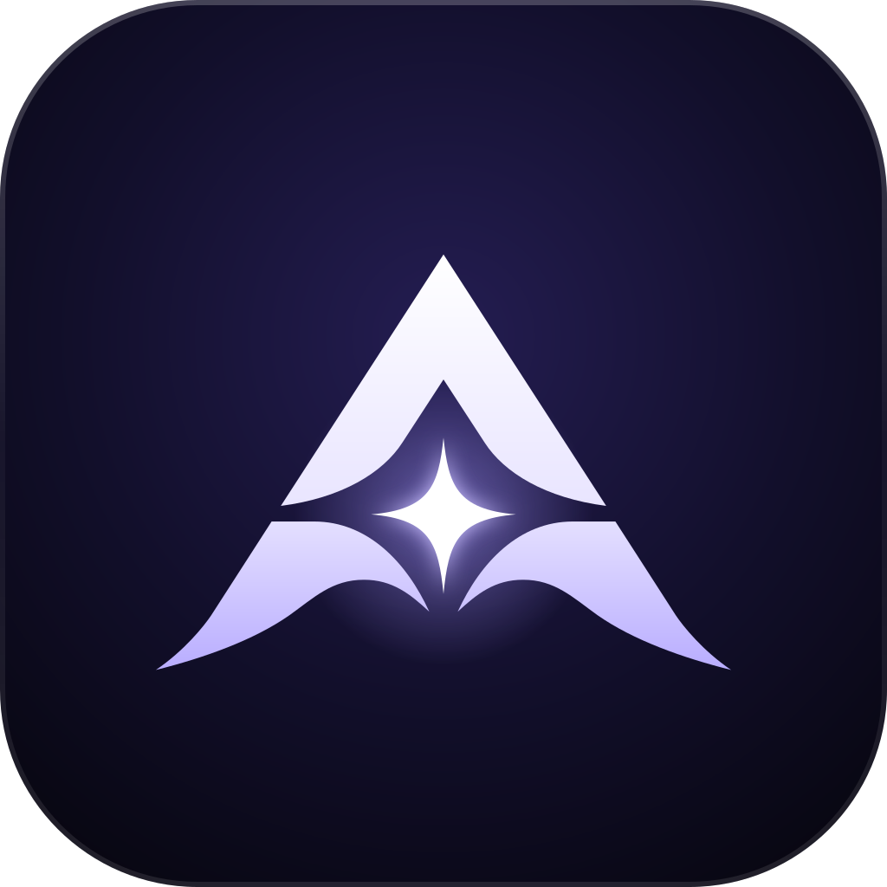
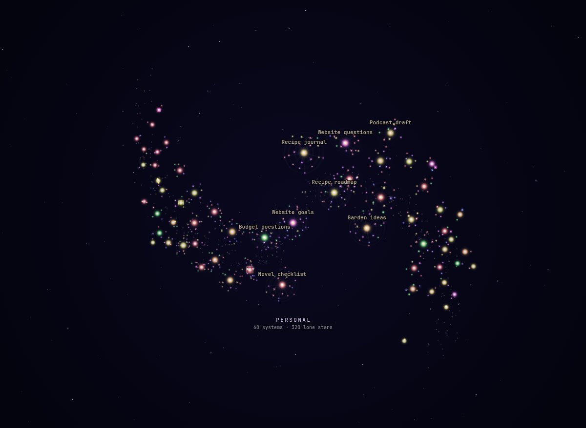
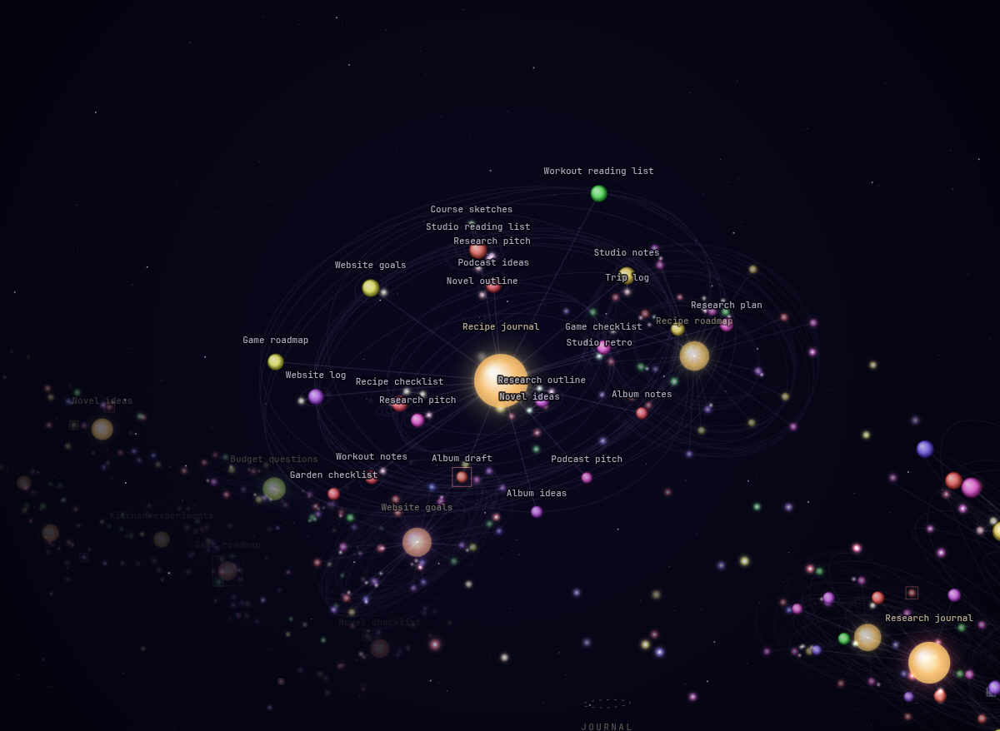
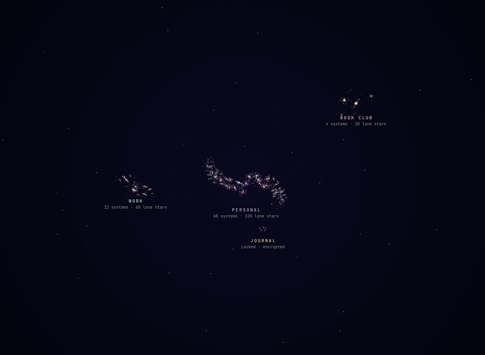
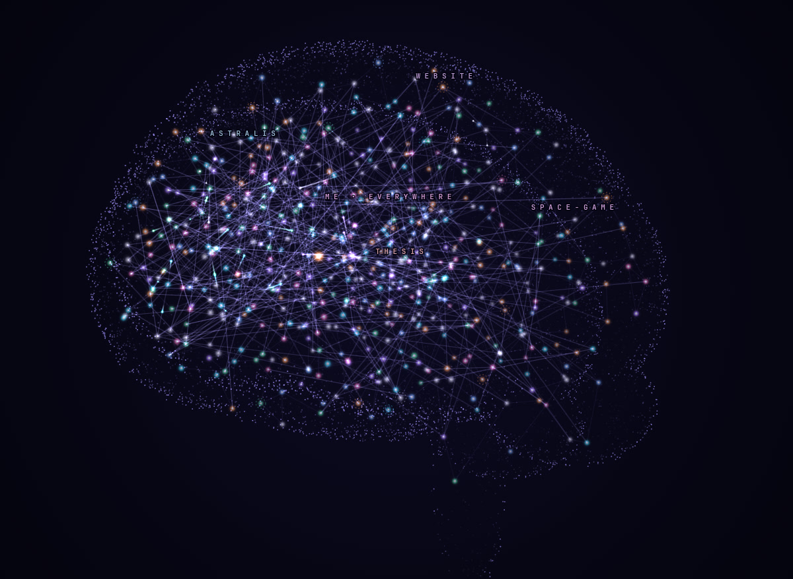
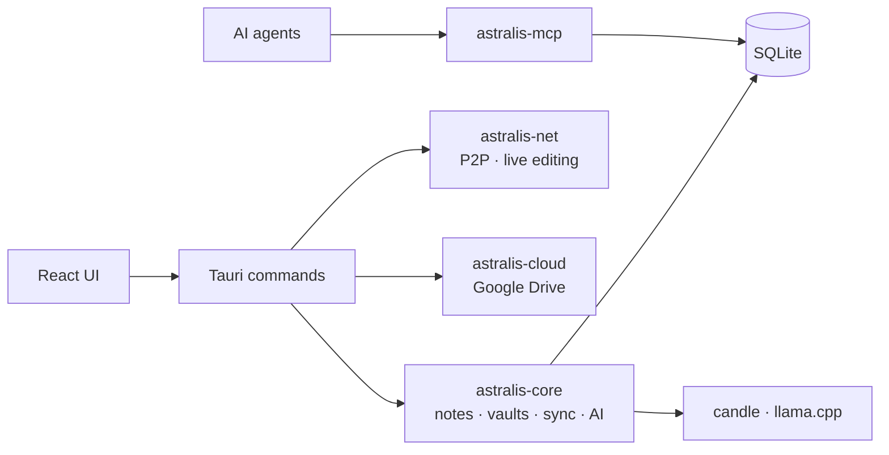

<p align="center">
  
</p>

<h1 align="center">Astralis</h1>

<p align="center">
  <b>Your notes, as a universe.</b><br>
  A private, local-first notes app with a built-in AI that runs on your own computer.
</p>

<p align="center">
  <a href="LICENSE"></a>
  
  
  
  
  
</p>

<p align="center">
  <a href="#-download">Download</a> ·
  <a href="#-features">Features</a> ·
  <a href="#-your-notes-as-a-universe">The graph</a> ·
  <a href="#-ask-astralis">Ask Astralis</a> ·
  <a href="#-the-brain">The Brain</a> ·
  <a href="#-sync-and-collaboration">Sync</a> ·
  <a href="#-build-and-run">Build</a>
</p>

<p align="center">
  
  <br><sub>A vault of 1,000 notes, seen as a galaxy. Every glow is a note; every cluster is a solar system of linked notes.</sub>
</p>

---

## 📦 Download

Get the newest version from the [**releases page**](https://github.com/noxilith/Astralis/releases/latest).
Every platform has an installer and a portable version that runs without installing.

| | Install | Portable |
|---|---|---|
| **Windows** (10, 11) | `…_windows_x64_setup.exe`, an install wizard | `…_windows_x64_portable.exe`, a single file |
| **macOS** (Apple silicon) | `…_macos_arm64.dmg`: drag Astralis to Applications | `…_macos_arm64.app.zip`: unzip and run |
| **Linux** (x64) | `…_linux_x64.flatpak`: `flatpak install` it, or open it in your software center | `…_linux_x64.AppImage`: make it executable and run |
| **iOS** | Coming eventually | |

**Astralis keeps itself up to date.** It checks GitHub for a newer release when it starts (you
can turn that off) and installs it in whichever form you have, then restarts. Updates are
checked against the release's SHA-256 checksums before anything is replaced. Settings →
Updates shows your version and lets you check any time.

> [!NOTE]
> The macOS build isn't notarized by Apple yet, so the first time, right-click Astralis and
> choose **Open**. Windows may show a SmartScreen warning for the same reason; choose
> **More info → Run anyway**.

## ✨ Features

<table>
  <tr>
    <td width="50%" valign="top">
      <h3>📝 Notes that stay yours</h3>
      Notes, whiteboards and nested folders in separate <b>vaults</b>, optionally encrypted.
      Tags, <code>[[wiki links]]</code> and backlinks, version history, templates, full-text
      search, and offline grammar checks. Plus tasks, a calendar and project boards.
    </td>
    <td width="50%" valign="top">
      <h3>🔥 Ask Astralis</h3>
      A brutally honest AI for the note you're on. It tells you when an idea is bad, whether
      it'll pay off, comes up with ideas, makes plans and writes the note. It runs entirely on
      your computer.
    </td>
  </tr>
  <tr>
    <td width="50%" valign="top">
      <h3>🧠 The Brain</h3>
      Project memory for AI coding agents like Claude Code, Codex and Cursor. They remember your
      decisions and conventions instead of re-reading files, so they spend far fewer tokens.
    </td>
    <td width="50%" valign="top">
      <h3>📡 Sync without a server</h3>
      Peer-to-peer between your devices, live editing with named carets, shared vaults, and
      Google Drive with end-to-end encryption. No Astralis account, no Astralis cloud.
    </td>
  </tr>
</table>

## 🌌 Your notes, as a universe

Every vault is a **3D galaxy** you can fly around. Notes that link to each other form
**solar systems**: the most-linked note is the sun, notes linked to it are planets on tilted
orbits, and notes reached through a planet are its moons. Unlinked notes are lone stars along
the spiral arms. There's no picture behind them, so a big vault looks like a galaxy and a small
one like a scatter of stars.

<table>
  <tr>
    <td width="50%"></td>
    <td width="50%"></td>
  </tr>
  <tr>
    <td align="center"><sub>Up close: a sun, its planets and moons</sub></td>
    <td align="center"><sub>Every vault a galaxy (locked ones stay cloaked)</sub></td>
  </tr>
</table>

Drag to turn, <kbd>Ctrl</kbd> + scroll to zoom, click a galaxy or system to fly there, and click
a planet to open the note.

## 🔥 Ask Astralis

Open a note's side panel, switch to **Chat**, and talk to a local language model (Microsoft's
Phi-3 mini on [llama.cpp](https://github.com/ggml-org/llama.cpp)) about it. It's built to be
honest rather than nice:

> **You:** Should I make this?
>
> **Astralis:** **Verdict:** Weak idea.<br>
> **What's wrong with it:** No unique hook in a crowded genre, no shipped game yet, and an
> unclear path to sales.<br>
> **Will it pay off?** Not worth it yet: $500–3,000 and months of learning against an uncertain
> return.<br>
> **Should you do it?** Only if you test the core mechanic first. Build a one-week prototype.

| Ask it to… | You get |
|---|---|
| **Be brutally honest** | A verdict, what's wrong with it, and whether to do it |
| **Will it pay off?** | Realistic cost against realistic payoff, with a clear call |
| **Give me ideas** | Ideas that fit, each with its competition and payoff, and a pick |
| **Make a plan** | Scope, phases, milestones and a first step for today |
| **Write it up** | The whole note rewritten. It can replace the note or be added to it, and it's undoable |

The model is a one-time 2.4 GB download. It loads on your first message and is freed when you
close the panel. It runs on the CPU; graphics-chip support (Vulkan, or Metal on macOS) is an
early build option, `ASTRALIS_GPU=1 ./run.sh app`, then `ASTRALIS_LLM_GPU=1` to turn it on.

## 🧠 The Brain



AI coding agents forget everything between chats, so they re-read your files and history every
time. **The Brain** gives them a memory: short Markdown notes about each project (decisions,
conventions, gotchas, a map of the code) plus a section about you.

- Agents read and write it through an [MCP](https://modelcontextprotocol.io) server,
  `astralis-mcp`, with answers kept small to save tokens.
- You review what they save in the app, and it's mirrored to a plain Markdown folder.
- **Brain → Connect** sets it up and installs the
  [`astralis-brain` skill](skills/astralis-brain/SKILL.md), which teaches the agent to use it
  well.
- Its graph is a rotatable 3D brain with each project in its own region.

<br clear="right">

## 📡 Sync and collaboration

- **Peer-to-peer** between your devices over encrypted QUIC ([iroh](https://iroh.computer)),
  on your network or anywhere through relays. Pair with a 6-digit code.
- **Live editing** while connected: text streams as you type, with each person's caret in
  their own colour.
- **Shared vaults**: share one vault with another device. It shows up as its own vault there,
  never touches their others, and disappears when you stop sharing.
- **Google Drive**: keep a vault on your Drive and invite people by email. Everything on Drive
  is end-to-end encrypted, and the app can only see the files it created. See
  [docs/google-drive-setup.md](docs/google-drive-setup.md) to build with your own Google client.

Under the hood, changes carry hybrid logical clocks and apply in any order; note text merges
as a CRDT, so two people editing at once both keep their changes.

## 🔒 Privacy

- Notes live in a local SQLite database. **Nothing is sent anywhere** unless you sync it.
- All AI runs on your device and never sees notes in encrypted vaults (Argon2id +
  XChaCha20-Poly1305).
- The only downloads are the AI models, from Hugging Face, when you ask for them.

## 🚀 Build and run

```bash
./run.sh app        # build and launch the desktop app
```

The first build compiles llama.cpp and takes several minutes; `run.sh` keeps it within a
laptop's memory.

<details>
<summary><b>Requirements</b>: Rust, Node.js 20+, CMake and a C++ toolchain</summary>

<br>

| System | Install |
|---|---|
| Arch | `sudo pacman -S --needed webkit2gtk-4.1 base-devel cmake clang` |
| Debian / Ubuntu | `sudo apt install libwebkit2gtk-4.1-dev build-essential cmake libclang-dev` |
| macOS | Xcode command line tools and `brew install cmake` |
| Windows | Visual Studio Build Tools (C++), CMake and LLVM |

Set `CARGO_BUILD_JOBS` higher than the default 4 if you have RAM to spare.

**Graphics-chip build** (`ASTRALIS_GPU=1`): on Linux and Windows also install the Vulkan headers
and `glslc` (Arch: `vulkan-headers shaderc spirv-headers`; Debian/Ubuntu: `libvulkan-dev glslc
spirv-headers`; Windows: the [Vulkan SDK](https://vulkan.lunarg.com/)). If SPIRV-Headers isn't
installed, `run.sh` fetches it into `.deps/`. macOS uses Metal and needs nothing extra.

</details>

<details>
<summary><b>All <code>run.sh</code> commands</b></summary>

<br>

| Command | What it does |
|---|---|
| `./run.sh app` | Desktop app in dev mode (hot reload) |
| `./run.sh second [profile]` | A second window with its own profile, to try sync on one machine |
| `./run.sh ui` | Frontend only, in a browser, with a mock backend |
| `./run.sh test` | Rust test suite |
| `./run.sh build` | Release installers (the official ones are built by GitHub Actions on each version tag) |
| `./run.sh fetch-model` | The note-embedding model (~90 MB), for related notes and auto-tags |
| `./run.sh seed-test-vault [profile]` | A 1,000-note test vault, for the graph |
| `./run.sh seed-test-brain [--fresh] [profile]` | 1,000 test memories in the Brain |
| `./run.sh check` / `clippy` / `fmt` | Rust tooling |

</details>

<details>
<summary><b>How it's built</b></summary>

<br>



| Folder | What's in it |
|---|---|
| `crates/astralis-core` | All app logic, UI-agnostic and tested: notes, vaults, encryption, sync, the Brain, the AI |
| `crates/astralis-net` | Peer-to-peer: pairing, sync, live editing |
| `crates/astralis-cloud` | Google sign-in, Drive client, end-to-end encrypted cloud sync |
| `crates/astralis-mcp` | The Brain's MCP server for AI agents |
| `apps/desktop` | The Tauri 2 app: Rust commands in `src-tauri/`, React + TypeScript UI in `src/` |
| `skills/astralis-brain` | The skill that teaches AI agents to use the Brain |

</details>

## 🧭 Planned

An iOS app, more cloud drives (OneDrive, Dropbox, Box, pCloud), biometric unlock, voice-to-text, and a
fine-tuned Astralis model.

---

<p align="center">
  <sub>Astralis is free software under the <a href="LICENSE">GNU GPL v3.0 or later</a>.</sub>
</p>
